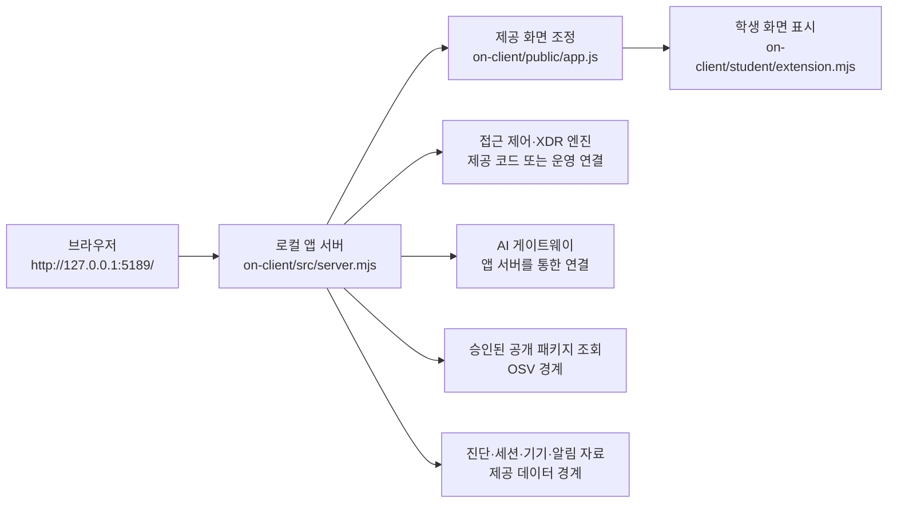

# 케셰브 학생 실행 설명서

이 문서는 21단계 제출용 학생 문서입니다. 현재 프로젝트에서 실제로 확인한 파일 경로와 실행 명령을 적고, 코드 읽기만으로 확인한 내용과 실제 화면에서 확인해야 할 내용을 구분합니다.

## 1. 프로젝트 범위와 실행 위치

이 저장소의 앱 폴더는 Git 최상위 폴더 아래의 `on-client`입니다. PowerShell은 이 앱 폴더에서 열어야 합니다.

현재 검토 환경에서 확인한 앱 폴더는 다음과 같습니다.

```text
C:\Users\서효상\AppData\Local\ALEPH\Workbench\projects\케셰브-방어전\on-client
```

다른 컴퓨터에서는 `C:\Users\<사용자>\AppData\Local\ALEPH\Workbench\projects\<프로젝트>\on-client`에 해당하는 실제 경로로 바꿉니다. 명령 안에 사용자 계정 비밀번호, 토큰, API 키, AI 서비스 원본 키를 넣지 않습니다.

현재 파일에서 확인한 기본 정보:

| 항목 | 확인값 | 확인 방법 |
|---|---|---|
| 프로젝트 이름 | `alekov-client-starter` | `on-client/package.json` 읽기 |
| 프로젝트 버전 | `0.2.11` | `on-client/package.json` 읽기 |
| Node.js 선언 버전 | `24.19.0` | `package.json`의 `engines.node` 읽기 |
| 이 검토 환경의 Node.js | `v24.20.0` | `node --version` 실행 |
| 이 검토 환경의 npm | `11.19.0` | `npm --version` 실행 |
| 외부 npm 의존성 | `package.json`에 `dependencies` 없음 | `package.json` 읽기 |
| 기본 포트 | `5189` | `start-alekov.ps1`, `.env.example` 읽기 |

Node.js는 프로젝트가 허용하는 22–24 계열을 사용하며, 수업 기준 버전은 `24.19.0`입니다. 이 환경에서는 같은 24 계열인 `24.20.0`이 실행 중임을 확인했지만, 24.19.0과 완전히 동일한 실행 결과라고 단정하지 않습니다.

## 2. 폴더 구조

```text
<Git 최상위 폴더>/
└─ on-client/
   ├─ package.json                 # 실행 스크립트와 Node.js 선언 버전
   ├─ public/
   │  ├─ index.html                # 제공 화면의 HTML
   │  ├─ app.js                    # 제공 화면의 조회·상태 조정
   │  ├─ style.css
   │  └─ vulnerabilities-view.mjs
   ├─ src/
   │  ├─ server.mjs                # 로컬 앱 서버와 API 경계
   │  ├─ ai/                       # AI 서비스 연결 경계
   │  ├─ actions/                  # 조치 준비·전달·결과 조회 경계
   │  └─ vulnerabilities/           # 패키지·취약점 조회 경계
   ├─ student/
   │  ├─ extension.mjs             # 학생이 작성한 화면 표시 함수
   │  └─ engine-adapter.mjs         # 제공 화면에 전달되는 엔진 어댑터
   ├─ vendor/
   │  └─ clco-http.mjs              # 제공된 HTTP 전송 모듈
   ├─ tools/
   │  └─ start-alekov.ps1           # 로컬 서버 시작 도구
   └─ docs/                         # 과제·학생 문서
```

현재 작업에는 `package-lock.json` 또는 `npm-shrinkwrap.json`이 파일 목록에서 확인되지 않았습니다. 따라서 패키지 취약점 조회가 실제로 완료되었다고 이 문서에서 주장하지 않습니다. 20단계의 `renderVulnerabilities`는 제공 화면이 전달한 조회 결과를 표시하는 학생 함수이며, 실제 lock 파일 대조와 OSV 조회는 제공 서버 범위입니다.

## 3. 설치·실행

### 3.1 PowerShell에서 앱 폴더 열기

```powershell
Set-Location 'C:\Users\서효상\AppData\Local\ALEPH\Workbench\projects\케셰브-방어전\on-client'
```

경로가 다른 컴퓨터에서는 위 경로를 그 컴퓨터의 실제 `on-client` 경로로 바꿉니다. 반드시 `package.json`과 `tools\start-alekov.ps1`이 보이는 폴더인지 확인합니다.

### 3.2 권장 시작 명령

```powershell
powershell -NoProfile -ExecutionPolicy Bypass -File .\tools\start-alekov.ps1
```

이 스크립트는 한 번 실행하는 PowerShell 프로세스 범위에서 `-ExecutionPolicy Bypass`를 사용합니다. 전역 실행 정책을 바꾸거나 다른 프로세스를 종료하지 않습니다. 외부 패키지 설치나 자격 증명 입력도 하지 않습니다.

### 3.3 정상 시작 신호

스크립트가 다음 문장을 출력하면 로컬 HTTP 서버가 응답했다는 뜻입니다.

```text
케셰브가 켜졌습니다. 브라우저에서 http://127.0.0.1:5189/ 을 여세요.
서버가 응답한 것만 확인했습니다. AI 연결 상태는 화면에서 따로 확인해 주세요.
끄려면 이 창에서 Ctrl+C 를 누르세요.
```

첫 두 문장은 서버 응답과 브라우저 주소를 뜻할 뿐입니다. AI 연결 성공, 계정 권한 확인, 사건 설명 성공, 보안 조치 효과 확인을 뜻하지 않습니다.

브라우저에서 다음 주소를 엽니다.

```text
http://127.0.0.1:5189/
```

상단 상태 영역과 `보호 현황`이 표시되는지 확인합니다. 이 문서를 작성하는 동안에는 새 브라우저 창에서 위 절차를 실제로 재실행하지 않았으므로, 화면 표시와 버튼 동작은 미확인입니다.

### 3.4 대체 시작 명령

시작 스크립트를 사용할 수 없을 때 같은 `on-client` 폴더에서 다음을 실행합니다.

```powershell
npm start
```

`npm start`는 `node src/server.mjs`를 실행합니다. 정상 실행 후 브라우저 주소는 기본적으로 `http://127.0.0.1:5189/`입니다.

포트가 사용 중이면 다른 프로세스를 종료하지 말고 다음처럼 다른 포트를 지정합니다.

```powershell
powershell -NoProfile -ExecutionPolicy Bypass -File .\tools\start-alekov.ps1 -Port 5190
```

이 경우 브라우저 주소는 `http://127.0.0.1:5190/`입니다.

### 3.5 데모와 정적 문법 검사

```powershell
npm run demo
```

`demo`는 예시 자료를 사용하는 모드입니다. 회사 시스템 연결, 실제 AI 연결, 실제 보안 조치, 과제 통과를 의미하지 않습니다.

```powershell
npm run check
```

`check`는 `student/extension.mjs`의 Node.js 문법만 검사합니다. 브라우저 DOM 동작, 로컬 서버 API, AI 모델 응답, OSV 조회를 검증하지 않습니다.

### 3.6 종료와 재실행

포그라운드로 실행한 PowerShell 창에서 다음 순서로 종료합니다.

1. 실행 중인 PowerShell 창을 활성화합니다.
2. `Ctrl+C`를 누릅니다.
3. 서버 종료 메시지를 확인한 뒤 창을 닫습니다.

재실행하려면 같은 `on-client` 폴더에서 권장 시작 명령을 다시 실행하고, 서버가 안내한 포트의 주소를 브라우저에서 새로 엽니다. 브라우저 새로고침이나 서버 재시작만으로 계정 연결·AI 권한·보안 조치가 자동으로 승인되지는 않습니다.

## 4. 시스템 구성도와 데이터 흐름



같은 흐름을 글로 쓰면 다음과 같습니다.

1. 브라우저가 로컬 앱 서버에서 제공 화면과 학생 확장 모듈을 받습니다.
2. `public/app.js`가 로컬 앱 서버의 API를 호출하고, 서버가 검증·정리한 입력을 학생 함수에 전달합니다.
3. `student/extension.mjs`는 전달받은 값을 `createElement`와 `textContent`로 표시합니다. 학생 함수에서 API 경로를 직접 호출하거나 인증 토큰·비밀번호·API 키를 읽지 않습니다.
4. 접근 제어·XDR 자료, 기기·세션·진단 자료, 패키지 조회 자료는 제공 서버/엔진 경계에서 옵니다.
5. AI 연결 점검과 사건 설명은 앱 서버가 AI 게이트웨이와 통신하는 경계입니다. 브라우저 학생 코드가 AI 회사 원본 키나 임의 대체 연결을 사용하지 않습니다.
6. 조치 준비·전달·결과 재조회는 제공 화면과 서버 경계의 기능입니다. 학생 함수는 제안과 서버가 전달한 상태를 표시할 뿐 POST 요청이나 인증 티켓을 만들지 않습니다.

## 5. 학생 작성 부분과 제공 코드 경계

| 영역 | 실제 파일·함수 | 역할 | 이 문서에서 확인한 범위 |
|---|---|---|---|
| 학생 확장 진입점 | `student/extension.mjs`의 `createStudentView` | 제공 화면에 학생 표시 함수를 묶어 반환 | 코드 읽기로 확인 |
| 신원·접근 판정 | `renderIdentity`, `renderDecision` | 전달받은 신원·접근 상태 표시 | 코드 읽기로 확인 |
| 보안 기록 | `renderEvents` | 기록 목록, 필터, 상세 근거·규칙·상태 표시 | 코드 읽기로 확인 |
| 보호 현황 | `renderStatus` | 기기·세션·진단 상태, 알림, 도움정보 복사 표시 | 코드 읽기로 확인 |
| 패키지 조회 | `renderVulnerabilities` | 조회 상태, lock 메타데이터, 정확한 설치 버전, 취약점 항목 표시 | 코드 읽기로 확인 |
| AI 연결 | `renderAiConnection` | `idle`·`loading`·`ok`·`error`, `test`·`verified`, 모델 수와 점검 시각 표시 | 코드 읽기로 확인; 실제 연결 미확인 |
| AI 사건 설명 | `renderExplanation` | 선택 이벤트에 대한 참고용 설명, 근거·규칙·unknown 상태·제안 표시 | 코드 읽기로 확인; 실제 모델 호출 미확인 |
| 조치 결과 표시 | `renderAction` | 준비·전달·접수·효과 관측·결과 불명 상태 표시 | 코드 읽기로 확인; 실제 집행 미확인 |
| 제공 화면 조정 | `public/app.js` | API 호출, 취소·세대 관리, 학생 함수에 입력 전달 | 제공 코드 경계; 학생 수정 대상 아님 |
| 로컬 서버 | `src/server.mjs` | 정적 파일 제공, API, 안전한 응답 정리와 서비스 경계 | 제공 코드 경계; 학생 수정 대상 아님 |
| HTTP 전송 | `vendor/clco-http.mjs` | 제공된 AI HTTP 전송 경계 | 제공 코드 경계; 학생 수정 대상 아님 |
| 시작 도구 | `tools/start-alekov.ps1` | Node 버전·포트·앱 폴더 점검과 로컬 서버 시작 | 코드 읽기로 명령과 검사를 확인 |

## 6. 구현 기능과 상태 확인 순서

학생 함수는 색상만으로 상태를 구분하지 않고 상태값과 한국어 문장을 함께 표시합니다. 다음 표의 “확인”은 실제 화면을 실행했다는 뜻이 아니라, 현재 학생 코드와 입력 계약을 읽어 확인했다는 뜻입니다.

| 기능 | 상태·표시 원칙 | 오류 또는 빈 자료 확인 순서 |
|---|---|---|
| 기기·세션·진단 | `loading`, `ok`, `error`, 빈 목록을 분리 | 먼저 현재 상태와 `message`를 읽고, 실패이면 화면 위쪽의 `다시 불러오기`를 사용자가 직접 눌렀는지 확인합니다. 자동 재요청은 기대하지 않습니다. 세션은 현재 검증된 연결 하나입니다. |
| 알림 | `resource`, `code`, `message`를 항목별 표시 | 알림 배열이 비면 알림 없음으로 읽습니다. 빈 값과 조회 실패를 같은 상태로 보지 않습니다. |
| 진단 정보 | 제공 화면이 전달한 안전한 필드만 표시 | `requestId`, `component`, `version`, `checkedAt`, `engine.mode`, `engine.code`만 확인합니다. `도움정보 복사`는 사용자가 누를 때만 동작하는 버튼입니다. |
| 보안 기록 | 기록 목록과 선택한 상세를 현재 이벤트에 맞춰 표시 | 다른 기록을 선택하거나 새로고침하면 이전 상세를 현재 결과로 남기지 않습니다. |
| AI 연결 | `idle`·`loading`·`ok`·`error` 분리 | `test`와 `verified`를 구분하고, 연결 점검만으로 사건 설명 성공이라고 쓰지 않습니다. 취소·시간 초과·권한·한도·모델 없음은 안전한 코드와 안내 방향으로 구분합니다. |
| AI 사건 설명 | 선택 이벤트의 ID, 요약, 근거 ID·문장, 규칙, unknown 상태, 제안 표시 | 설명 실패·근거 불일치·이벤트 없음이면 성공 속성을 붙이지 않고 기록을 그대로 둡니다. 제안은 참고용이며 실행하지 않습니다. |
| 조치 상태 | `prepared`, `executing`, `pending`, `succeeded` 등을 원래 값과 함께 표시 | 접수(ACK)를 성공으로 쓰지 않습니다. `succeeded`라도 `effectApplied: true`가 확인된 경우에만 효과 확인으로 표시합니다. |
| 패키지·취약점 | 전체 조회 상태와 패키지의 정확한 설치 버전·조회 출처·취약점 ID 표시 | `not_checked`, `not_configured`, `unverifiable`, `partial`을 취약점 없음과 구분합니다. `none_found`도 조회 범위에서 알려진 항목이 없다는 뜻이지 전체 안전 보장이 아닙니다. |

## 7. 장애 확인과 복구 순서

| 증상 | 확인 | 복구 방법 | 이 문서 작성 시 실제 화면 확인 |
|---|---|---|---|
| Node.js를 찾지 못함 | 같은 PowerShell에서 `node --version` | Node.js 22–24 계열을 설치하고 PowerShell을 다시 엽니다. 수업 기준은 24.19.0입니다. | 미확인 |
| 시작 파일을 찾지 못함 | 현재 폴더에 `package.json`, `tools\\start-alekov.ps1`가 있는지 확인 | `on-client`로 이동한 뒤 시작합니다. | 경로 존재는 확인, 재실행은 미확인 |
| 포트 5189 사용 중 | 시작 도구의 포트 오류를 확인 | 다른 프로세스를 종료하지 말고 `-Port 5190`으로 시작하고 `http://127.0.0.1:5190/`을 엽니다. | 미확인 |
| 서버 대기 시간이 초과됨 | 시작 PowerShell의 전체 출력 확인 | 다른 실행을 겹쳐 시작하지 말고 출력 전체를 담당자에게 전달합니다. AI 성공으로 해석하지 않습니다. | 미확인 |
| 화면에 조회 실패가 표시됨 | 상태값, 안전한 `code`, `message` 확인 | 원인에 맞는 제공 화면의 재조회 버튼을 사용자가 직접 누릅니다. 이전 오류가 자동으로 사라졌다고 쓰지 않습니다. | 미확인 |
| AI 연결 점검 실패 | 권한 준비, 인증, 접근 제한, 한도, 이용 시간, 요청 제한, 시간 초과, 네트워크, 취소, 모델 없음 순으로 코드 확인 | 권한·계정 문제는 담당자 확인, 일시적 요청 문제는 잠시 뒤 사용자가 직접 재점검합니다. 키를 붙여 넣지 않습니다. | 실제 연결 미확인 |
| AI 설명 실패 또는 근거 불일치 | 선택한 이벤트 ID와 `evidenceIds` 대조 | 기록은 그대로 두고 설명을 성공으로 표시하지 않습니다. 유료 재요청을 반복하지 않습니다. | 실제 모델 응답 미확인 |
| 조치 상태가 unknown | `requestId`, `receiptId`, 관측 결과 확인 | 성공이나 효과 없음으로 단정하지 말고 제공 화면의 결과 재조회를 사용합니다. 학생 코드에서 POST를 추가하지 않습니다. | 실제 집행 미확인 |
| 취약점 조회가 partial/not_checked/not_configured/unverifiable | 전체 조회 상태와 패키지별 상태 확인 | 조회 실패를 취약점 없음으로 바꾸지 않습니다. 패키지를 낮춰 취약점을 만들지 않습니다. | 실제 OSV 조회 미확인 |

## 8. 지원 범위와 확인하지 않은 기능

현재 기본 시작은 로컬 앱 서버와 예시·연결 끊김 상태를 보여 주는 범위입니다. `npm run demo`의 결과나 서버 시작 문구만으로 회사 계정, AI 권한, XDR 사건, 보안 조치의 실제 성공을 주장하지 않습니다.

다음 항목은 이 문서 작성 중 실제 계정·운영 시스템·브라우저에서 확인하지 않았습니다.

- 실제 접근 제어·XDR 시스템의 실시간 자료 수신
- 준비된 운영 계정으로 `verified` AI 연결 성공
- 보안 기록에서 실제 AI 사건 설명 모델 응답
- 취소 뒤 늦은 AI 응답이 화면에 반영되지 않는 실제 네트워크 확인
- 조치의 실제 전달·ACK·효과 관측
- package-lock과 node_modules의 실제 대조 및 OSV 조회 성공
- SDP 호스트 또는 네이티브 호스트의 운영 권한 연결

SDP 또는 네이티브 호스트 설정 파일은 운영자가 제공한 실제 절대 경로를 시작 도구 옵션으로 전달할 때만 사용합니다. 예시는 다음과 같지만, 실제 설정 파일의 내용이나 키를 문서·화면·커밋에 적지 않습니다.

```powershell
powershell -NoProfile -ExecutionPolicy Bypass -File .\tools\start-alekov.ps1 -SdpHostConfig 'C:\AlekovPrivate\sdp-host.json'
```

`-Demo`와 SDP 설정을 함께 사용하지 않습니다. 설정 파일이 없거나 권한이 준비되지 않으면 학생 코드만으로 연결을 만들 수 없습니다.

## 9. 이 문서의 확인 기록

| 확인 분류 | 결과 |
|---|---|
| 코드·설정 파일 읽기 | `package.json`, `start-alekov.ps1`, `src/server.mjs`, `public/app.js`, `student/extension.mjs`, 기존 학생 문서를 대조함 |
| 로컬 도구 버전 | `node --version`은 `v24.20.0`, `npm --version`은 `11.19.0`으로 실제 실행해 확인함 |
| 경로 존재 | `on-client/package.json`, `tools/start-alekov.ps1`, `student/extension.mjs`, `src/server.mjs`, `public/app.js` 존재를 확인함 |
| 서버 시작·브라우저 화면 | 이 문서 작성 중 새 PowerShell과 브라우저로 재실행하지 않아 미확인 |
| 실제 AI·SDP·XDR·OSV·조치 | 운영 권한과 연동 시스템이 필요한 범위이므로 미확인 |
| 비밀값 | 문서에 비밀번호·토큰·API 키·AI 원본 키를 기록하지 않음 |

## 10. 21·22단계 제출 메모

학생 문서와 해당 단계의 변경을 같은 커밋에 저장합니다. 21·22단계는 과제 화면에 저장소 주소와 40자리 커밋을 직접 입력하는 방식입니다. 비공개 저장소라면 과제 화면의 `비공개 저장소 원문 준비 방법`에서 제공하는 도구를 프로젝트 밖에 풀고, Git 최상위 폴더에서 공식 명령을 실행합니다.

경로는 실제 도구와 출력 폴더로 바꾸며, 다음은 형식만 보여 주는 공식 명령입니다.

```powershell
node 'C:\도구\alekov-source-tool\student-source-cli.mjs' --output 'C:\제출자료\alekov-source.json' --commit '<제출할 40자리 커밋>'
```

이 명령을 이 문서 작성 중 실행했다고 주장하지 않습니다. 생성된 원문 묶음 전달과 AI 판정 통과는 서로 다르므로, 제출 뒤 서버의 판정 설명과 확인 불가 항목을 별도로 확인합니다.
